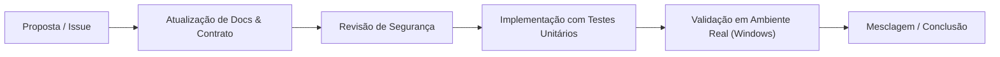

# Guia de Contribuição — MCP Corel

Agradecemos o interesse em contribuir para o **MCP Corel**! Este projeto segue padrões rigorosos de engenharia, segurança e clareza documental.

---

## 1. Princípios de Desenvolvimento

1. **Documentação Antes de Código:**  
   Nenhuma nova ferramenta ou funcionalidade do CorelDRAW deve ser codificada sem antes ter seu contrato documentado em `contracts/mcp-tools.md` e os critérios de aceite definidos.

2. **Evidência Obrigatória:**  
   Ao implementar qualquer melhoria, apresente a saída de teste real demonstrando o funcionamento. Não são aceitas afirmações sem logs comprovando o resultado.

3. **Idioma e Clareza:**  
   Todo o código-fonte deve ser documentado em português do Brasil, utilizando comentários claros e objetivos. Os relatórios para o usuário final devem ser acessíveis e em linguagem simples.

---

## 2. Fluxo de Trabalho de Alterações

1. **Definição da Ferramenta:** Proponha a ferramenta MCP ou funcionalidade com schemas de entrada e saída.
2. **Revisão de Segurança:** Garanta que a alteração não permite injeção de comandos, path traversal ou travamento do CorelDRAW.
3. **Testes com Simulação (*Mocks*):** Escreva testes unitários cobrindo casos normais e de erro sem depender do CorelDRAW físico.
4. **Verificação no Windows Real:** Execute o teste no CorelDRAW 2023 na máquina Windows 10 para colher evidência real antes do fechamento.

---

## 3. Padrões de Código e Estilo

- **Linguagem:** Python 3.11+.
- **Formatador e Linter:** Ruff (`ruff check .` e `ruff format .`).
- **Tipagem Estática:** Mypy (`mypy src/`).
- **Tratamento de Exceções:** Nunca silencie erros (`except: pass`). Capture a exceção COM específica do Windows e mapeie para os códigos de erro do projeto (`contracts/error-codes.md`).
