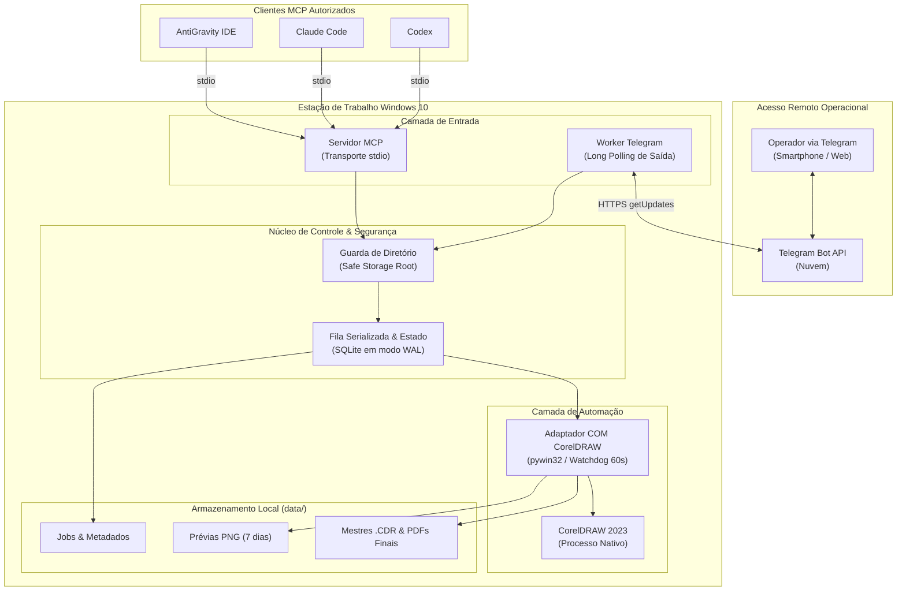

<div align="center">

# 🎨 MCP CorelDRAW 2023

**Servidor Model Context Protocol (MCP) para automação vetorial assistida por Inteligência Artificial no CorelDRAW 2023 (Windows 10) com canal remoto via Telegram.**

[](https://www.python.org/)
[](https://modelcontextprotocol.io/)
[](https://www.microsoft.com/windows)
[](LICENSE)
[](#-cronograma-e-fases-roadmap)

[Guia de Instalação no Windows](RELATORIO_E_PROXIMOS_PASSOS_WINDOWS.md) •
[Especificação Técnica](docs/SPEC.md) •
[Arquitetura](docs/ARCHITECTURE.md) •
[Modelo de Ameaças](docs/THREAT_MODEL.md) •
[Dicionário de Logs](docs/dicionario-logs.md)

</div>

---

> [!NOTE]
> **ESTADO ATUAL DO PROJETO: FASE 0 CONCLUÍDA**  
> Toda a documentação, governança de agentes, contratos de ferramentas MCP e schemas JSON foram finalizados e validados. **Nenhum código funcional de automação gráfica foi escrito ainda.** A integração real com a aplicação será validada via diagnóstico na máquina Windows alvo durante a **Fase 1**.

---

## 📋 Sumário
- [Visão Geral](#-visão-geral)
- [Diferenciais de Segurança](#-diferenciais-de-segurança)
- [Diagrama Geral de Arquitetura](#-diagrama-geral-de-arquitetura)
- [Como Puxar na Máquina Windows Correta](#-como-puxar-na-máquina-windows-correta)
- [Cronograma e Fases (Roadmap)](#-cronograma-e-fases-roadmap)
- [Catálogo de Ferramentas MCP](#-catálogo-de-ferramentas-mcp)
- [Estrutura do Repositório](#-estrutura-do-repositório)
- [Contribuição](#-contribuição)
- [Licença](#-licença)

---

## 🎯 Visão Geral

O **MCP Corel** é uma ponte de software que permite que clientes de IA (como **Google AntiGravity**, **Claude Code**, **Codex** e outros clientes compatíveis com o padrão MCP) controlem uma estação de trabalho local com **CorelDRAW 2023** no Windows 10.

O sistema recebe briefings em linguagem natural, converte em planos geométricos milimétricos, desenha objetos vetoriais, aplica regras de pré-impressão técnica (sangrias, marcas de corte e conversão em curvas), exporta prévias instantâneas em PNG e entrega arquivos fechados em PDF de alta qualidade e arquivos mestres `.CDR`.

---

## 🛡️ Diferenciais de Segurança

- 🔒 **Zero Portas Abertas no Windows:** O servidor MCP roda estritamente via comunicação de processos locais (`stdio`).
- 📡 **Operação Remota Segura por Long Polling:** A conexão com o Telegram é feita **de dentro para fora** (requisições HTTPS de saída). Nenhuma porta de entrada precisa ser liberada no firewall ou no roteador.
- 🚫 **Sem Shell Arbitrário:** Nenhuma instrução em texto recebida de chats é enviada para o terminal do Windows (`cmd.exe` ou `powershell.exe`).
- 📁 **Isolamento de Diretórios (Safe Storage Guard):** Todas as gravações e leituras de arquivos são restritas à pasta autorizada (`C:\mcp-corel\data`). Tentativas de *Path Traversal* (como `../`) são bloqueadas e registradas.
- 🔑 **Proteção de Credenciais:** Zero tokens reais ou credenciais de produção no repositório. O `.env` real é estritamente ignorado pelo Git.

---

## 🏗️ Diagrama Geral de Arquitetura



---

## 💻 Como Puxar na Máquina Windows Correta

Quando você estiver na máquina com **Windows 10** e **CorelDRAW 2023** instalado:

```powershell
# 1. Clonar o repositório no Windows
cd C:\
git clone https://github.com/caumodascdp-bot/mcp-corel.git
cd C:\mcp-corel

# 2. Criar e ativar o ambiente virtual Python 3.11+
python -m venv .venv
.\.venv\Scripts\Activate.ps1

# 3. Criar seu arquivo de ambiente local a partir do exemplo
copy .env.example .env
notepad .env
```

Para instruções detalhadas de inicialização, consulte o [Guia de Próximos Passos na Máquina Windows](RELATORIO_E_PROXIMOS_PASSOS_WINDOWS.md).

---

## 🗺️ Cronograma e Fases (Roadmap)

| Fase | Descrição | Estado Atual | Evidência Exigida |
| :---: | :--- | :---: | :--- |
| **Fase 0** | **Arquitetura, Governança e Contratos** | `verified` ✅ | Repositório estruturado, schemas validados, sem código executável. |
| **Fase 1** | **Diagnóstico e PoC COM CorelDRAW** | `planned` ⏳ | Diagnóstico real executado no Windows 10 comprovando controle do Corel. |
| **Fase 2** | **Servidor MCP Local & Fila de Jobs** | `planned` ⏳ | Testes unitários com mocks passando; stdio funcional com clientes de IA. |
| **Fase 3** | **Motor de Criação Gráfica & Exportação** | `planned` ⏳ | Criação de documentos, formas paramétricas e PDF fechado com marcas de corte. |
| **Fase 4** | **Bot Telegram (Long Polling Remoto)** | `planned` ⏳ | Notificações de prévia e aprovação remota via chat testada e sem portas abertas. |
| **Fase 5** | **Hardening, Testes End-to-End & MVP** | `planned` ⏳ | Suíte completa de testes aprovada e checklist de liberação v1.0.0 assinado. |

---

## 🛠️ Catálogo de Ferramentas MCP

O servidor MCP expõe 16 ferramentas especializadas (todas documentadas em [contracts/mcp-tools.md](contracts/mcp-tools.md)):

- `corel.get_status`: Consulta saúde da aplicação e tamanho da fila.
- `corel.run_diagnostics`: Inspeciona chaves COM, versão de bits e filtros de exportação.
- `corel.list_documents`: Lista documentos abertos na aplicação.
- `corel.create_document`: Cria novo documento vetorial com dimensões e espaço de cor (CMYK/RGB).
- `corel.get_document_info`: Retorna metadados da página, contagem de formas e camadas.
- `corel.create_shape`: Insere formas geométricas (retângulos, círculos, linhas).
- `corel.add_text`: Insere textos artísticos ou de parágrafo formatados.
- `corel.import_asset`: Importa imagens externas (PNG, JPG, SVG) da pasta segura.
- `corel.align_objects`: Alinha e distribui objetos vetoriais selecionados.
- `corel.preview`: Exporta imagem de prévia rápida em PNG a 150 DPI para inspeção visual.
- `corel.validate_artwork`: Validação técnica de pré-impressão (sangria, curvas, resolução).
- `corel.save_document`: Salva o documento ativo no formato nativo `.cdr`.
- `corel.export_document`: Exporta arquivo final para gráfica (PDF pré-impressão, EPS, SVG).
- `corel.get_job_status`: Consulta o andamento e erros de uma tarefa.
- `corel.cancel_job`: Cancela tarefas aguardando na fila.
- `corel.get_job_artifacts`: Retorna lista e hashes SHA-256 dos arquivos produzidos.

---

## 📂 Estrutura do Repositório

```
mcp-corel/
├── .env.example                     # Modelo seguro de variáveis de ambiente
├── pyproject.toml                   # Configuração e dependências do projeto Python
├── RELATORIO_E_PROXIMOS_PASSOS_WINDOWS.md # Guia prático para a máquina alvo
├── docs/                            # Especificações, manuais, arquitetura e ADRs
│   ├── SPEC.md                      # Requisitos funcionais e não-funcionais numerados
│   ├── ARCHITECTURE.md              # Diagramas e detalhes da arquitetura em camadas
│   ├── THREAT_MODEL.md              # Matriz STRIDE e controles de segurança
│   ├── dicionario-logs.md           # Dicionário de logs em português
│   └── decisions/                   # Registros de Decisão de Arquitetura (ADR-001 a ADR-005)
├── agents/                          # 11 Agentes de IA com papéis e restrições individuais
├── skills/                          # 10 Habilidades operacionais padronizadas (SOPs)
├── contracts/                       # Contratos de ferramentas e schemas JSON
│   ├── artwork-brief.schema.json    # Schema JSON Draft-07 para briefings de arte
│   └── artifact-manifest.schema.json# Schema JSON Draft-07 para manifesto de entrega
├── templates/                       # Modelos de leiaute (flyer, redes sociais, etiquetas, print)
├── src/mcp_corel/                   # Pacote Python (módulos planejados)
├── tests/                           # Suítes de testes (unitários, integração, segurança e aceitação)
├── data/                            # Pastas seguras de armazenamento de dados (jobs, prévias, artefatos)
└── logs/                            # Diretório para registros de auditoria
```

---

## 🤝 Contribuição

Contribuições são bem-vindas! Consulte o [Guia de Contribuição](CONTRIBUTING.md) para entender nossos padrões de código, testes obrigatórios e regras de segurança.

---

## 📄 Licença

Este projeto é distribuído sob os termos da licença [MIT](LICENSE).
