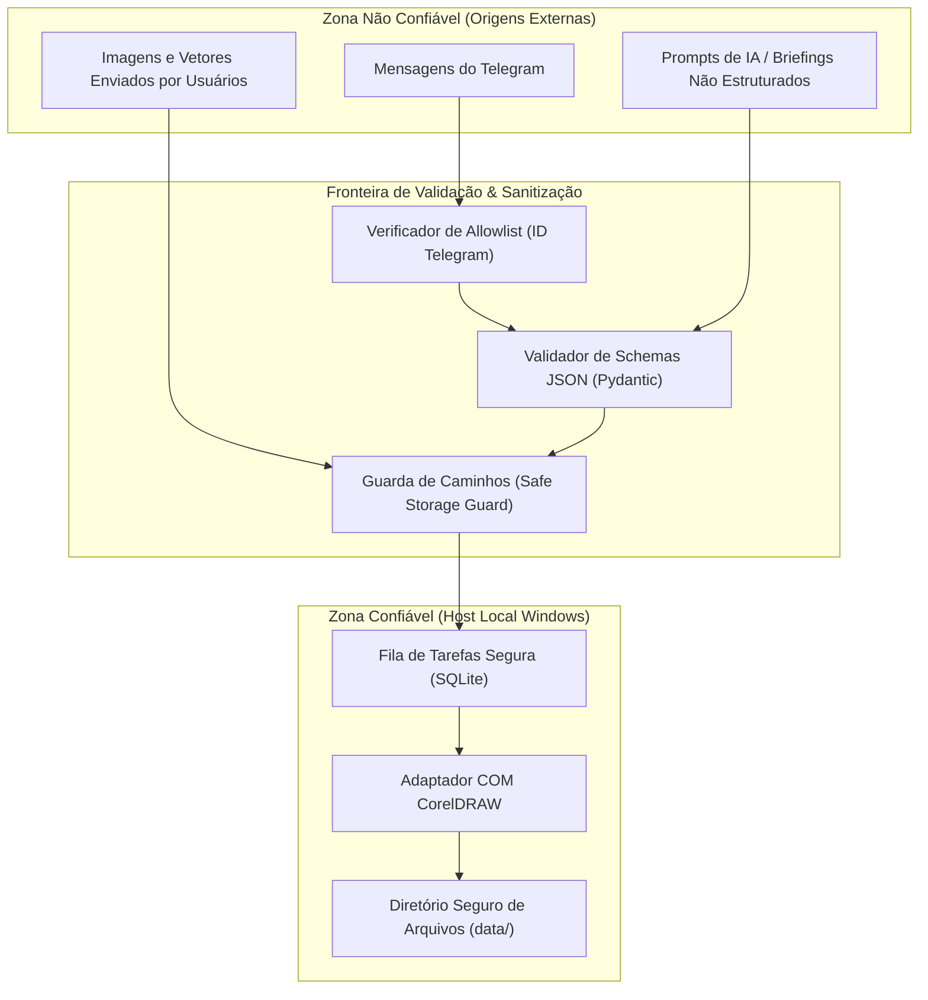

# Política de Segurança — MCP Corel

A segurança da estação de trabalho local e a integridade dos arquivos gráficos são prioridades absolutas no projeto **MCP Corel**.

---

## 1. Princípios de Segurança da Arquitetura

1. **Sem Portas de Entrada Abertas no Windows:**
   - O servidor MCP opera exclusivamente via comunicação de processos locais (`stdio`).
   - A comunicação remota via Telegram opera exclusivamente através de **conexões de saída (HTTPS Long Polling)**. Nenhuma porta de entrada (como 80, 443 ou portas personalizadas) deve ser aberta no firewall ou no roteador do Windows.

2. **Isolamento de Diretórios (Prevenção de Path Traversal):**
   - O sistema define um diretório raiz seguro (`SAFE_STORAGE_ROOT`).
   - Nenhuma ferramenta MCP ou comando do Telegram pode ler, gravar ou excluir arquivos fora deste diretório e de suas subpastas (`data/artifacts`, `data/previews`, `data/jobs`).
   - Tentativas de acessar caminhos contendo `..` ou caminhos absolutos do sistema (ex: `C:\Windows\`) são bloqueadas e registradas como incidentes de segurança.

3. **Bloqueio de Execução Arbitrária de Shell:**
   - Nenhum texto recebido via prompt de IA, instrução MCP ou chat do Telegram será passado para interpretadores de linha de comando (`cmd.exe`, `powershell.exe`, `bash`).

4. **Proibição de Macros Externas:**
   - O sistema nunca aceita, carrega ou executa arquivos de macro (.bas, .gms, .vba) fornecidos pelo usuário ou por IA em tempo de execução. Todo o controle do CorelDRAW é feito via chamadas tipadas da API COM encapsuladas no adaptador oficial.

5. **Controle de Sobrescrita e Destruição:**
   - Sobrescrita de arquivos existentes ou descarte de documentos não salvos requer confirmação explícita ou flag específica, prevenindo perda acidental de artes originais.

6. **Proteção de Segredos e Logs Limpos:**
   - Tokens de bot, chaves de API e caminhos confidenciais são excluídos de logs e mensagens de erro.
   - O repositório Git mantém `.env` e chaves privadas estritamente no `.gitignore`.

---

## 2. Fronteiras de Confiança (Trust Boundaries)

---

## 3. Relato de Vulnerabilidades

Se você identificar qualquer vulnerabilidade de segurança neste projeto (especialmente escape de sandbox de arquivos ou execução indevida de comandos):
1. **Não abra uma issue pública.**
2. Envie um relatório detalhado com passos de reprodução para a equipe responsável pelo repositório.
3. A equipe investigará e responderá com uma correção antes de qualquer divulgação pública.
