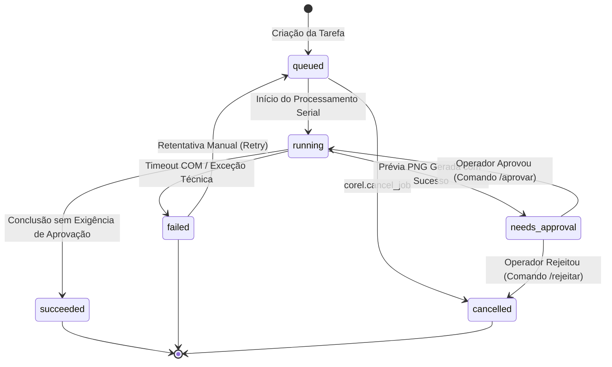

# Máquina de Estados de Tarefas — MCP Corel

Este documento formaliza os estados, transições válidas, regras de concorrência e estratégias de recuperação de falhas do ciclo de vida das tarefas no **MCP Corel**.

---

## 1. Estados Canônicos

| Estado | Significado | É Terminal? | Pode Sofrer Mutação no Corel? |
| :--- | :--- | :--- | :--- |
| `queued` | Tarefa inserida na fila e persistida no SQLite, aguardando início do processamento. | Não | Não |
| `running` | Tarefa em execução ativa pelo adaptador COM do CorelDRAW. | Não | **SIM (Exclusivo)** |
| `needs_approval` | Prévia visual renderizada; a execução aguarda confirmação humana (via Telegram ou MCP). | Não | Não (pausado) |
| `succeeded` | Tarefa finalizada com sucesso; documentos mestres e artefatos salvos e conferidos. | **SIM** | Não |
| `failed` | Falha irrecuperável (ex: timeout de COM, erro de disco, parâmetros inválidos). | **SIM** | Não |
| `cancelled` | Tarefa cancelada por solicitação do usuário antes de finalizar. | **SIM** | Não |

---

## 2. Diagrama de Transições Válidas



---

## 3. Matriz de Transições Permitidas

| De / Para | `queued` | `running` | `needs_approval` | `succeeded` | `failed` | `cancelled` |
| :--- | :---: | :---: | :---: | :---: | :---: | :---: |
| **`queued`** | ❌ | ✅ (Início da fila) | ❌ | ❌ | ❌ | ✅ (Cancelamento) |
| **`running`** | ❌ | ❌ | ✅ (Aguardando humano) | ✅ (Concluído) | ✅ (Erro/Timeout) | ❌ |
| **`needs_approval`** | ❌ | ✅ (Aprovado) | ❌ | ❌ | ❌ | ✅ (Rejeitado) |
| **`succeeded`** | ❌ | ❌ | ❌ | ❌ | ❌ | ❌ |
| **`failed`** | ✅ (Reenfileiramento) | ❌ | ❌ | ❌ | ❌ | ❌ |
| **`cancelled`** | ❌ | ❌ | ❌ | ❌ | ❌ | ❌ |

---

## 4. Recuperação de Falhas e Quedas de Energia (Crash Recovery)

Na inicialização do servidor MCP ou do worker do Telegram:
1. Uma transação SQL varre o banco `jobs.sqlite3` buscando qualquer registro com `status = 'running'`.
2. Como o processo foi interrompido antes do término limpo, estes registros são considerados **tarefas órfãs**.
3. A aplicação executa a atualização automática:
   ```sql
   UPDATE jobs
   SET status = 'failed',
       error_code = 'ERR_CRASH_ORPHAN_TASK',
       error_message = 'O servidor ou a estação foi desligada abruptamente durante a execução.'
   WHERE status = 'running';
   ```
4. A trava global de acesso ao CorelDRAW é liberada, garantindo que novas tarefas possam ser processadas sem deadlock.
