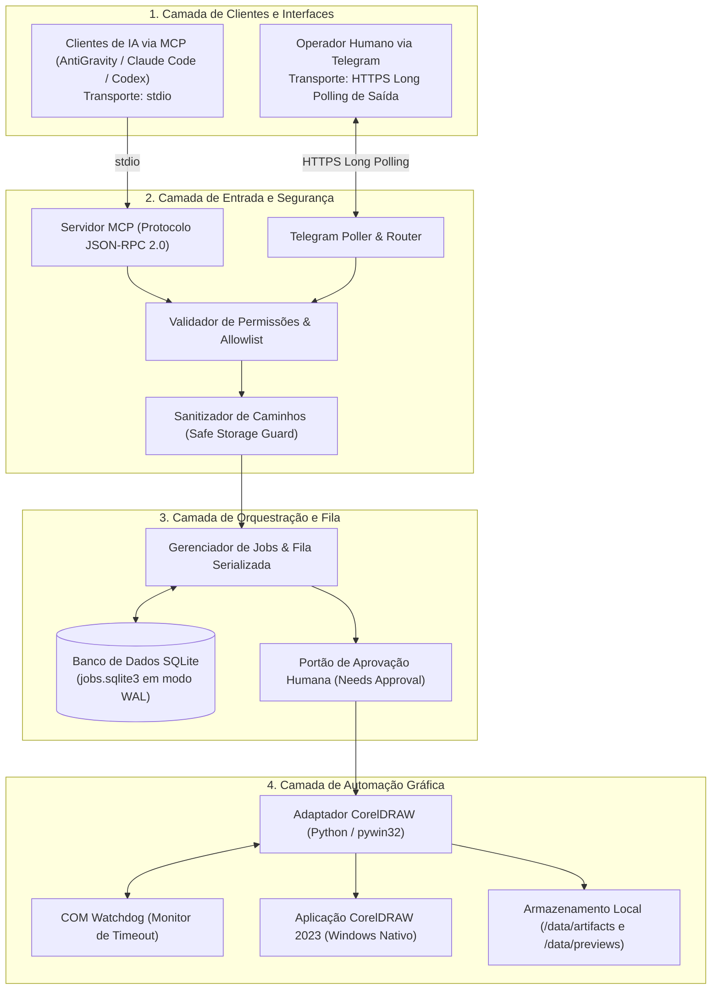
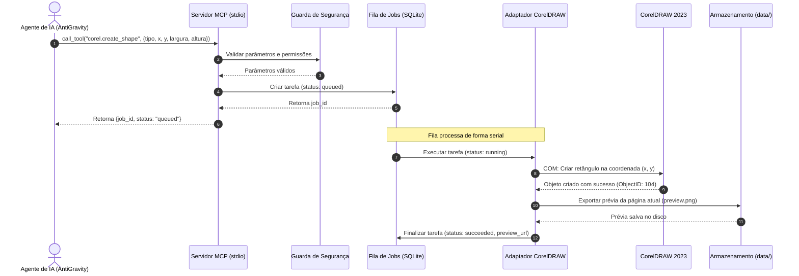
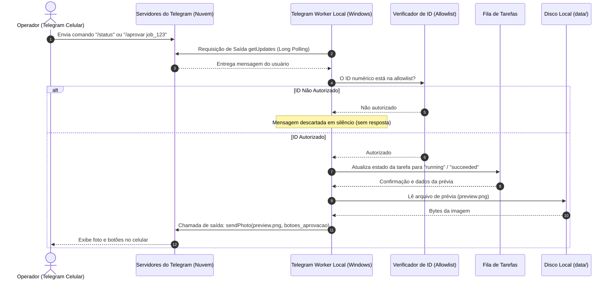
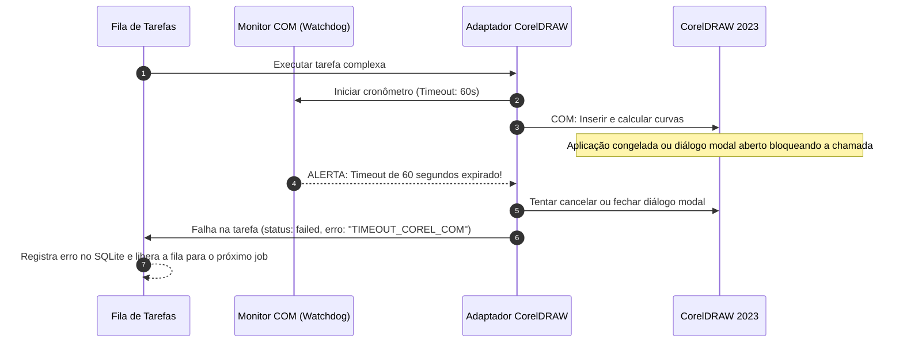

# Arquitetura do Sistema — MCP Corel

Este documento descreve os componentes, camadas de software, padrões de comunicação e modelos de dados do ecossistema **MCP Corel**.

---

## 1. Visão Arquitetural em Camadas

O sistema é dividido em quatro camadas bem delimitadas:

---

## 2. Componentes Principais

### 2.1 Servidor MCP (`src/mcp_corel/mcp/`)
- Implementa as especificações oficiais do Model Context Protocol (JSON-RPC sobre `stdio`).
- Mapeia chamadas de ferramentas (*tools*) para comandos validados da fila de tarefas.
- Retorna respostas imediatas com o identificador da tarefa (`job_id`) ou executa ações síncronas de leitura sem travar o cliente.

### 2.2 Worker Telegram (`src/mcp_corel/telegram/`)
- Módulo independente que se conecta à API oficial do Telegram através de chamadas periódicas de saída (*getUpdates* via long polling).
- **Sem portas de entrada:** Opera sem webhook aberto na máquina local.
- Garante que apenas mensagens de IDs permitidos em `TELEGRAM_ALLOWED_USER_IDS` sejam processadas.

### 2.3 Gerenciador de Tarefas e Estado (`src/mcp_corel/jobs/`)
- Enfileira todas as operações que modificam o CorelDRAW.
- Assegura a **serialização absoluta** (apenas 1 operação de desenho por vez no CorelDRAW).
- Persiste o histórico em SQLite (`data/jobs/jobs.sqlite3`), permitindo auditar o que foi executado, quem pediu, quando iniciou e quanto tempo demorou.

### 2.4 Adaptador CorelDRAW (`src/mcp_corel/corel/`)
- Encapsula a interface COM do Windows (`pywin32` / `win32com.client`).
- Trata tipos de dados, conversão de unidades (milímetros para pontos do CorelDRAW), gerenciamento de erros COM (HRESULTs) e timeouts com watchdog.
- Protege a aplicação contra janelas modais indesejadas (configurando supressão de diálogos de fontes ou avisos via propriedades de automação da aplicação).

### 2.5 Módulo de Armazenamento e Segurança (`src/mcp_corel/storage/` & `security/`)
- Garante que todos os caminhos gerados ou solicitados estejam contidos na pasta segura autorizada (`SAFE_STORAGE_ROOT`).
- Bloqueia manipulações indevidas em arquivos mestres (.cdr) já existentes.

---

## 3. Diagrama: Fluxo de Comando MCP

Este diagrama ilustra o ciclo de vida de uma requisição originada por um agente de IA via cliente MCP (como o AntiGravity):

---

## 4. Diagrama: Fluxo de Comando Remoto Telegram

Este diagrama ilustra como um operador humano remoto interage de forma segura pelo Telegram:

---

## 5. Diagrama: Recuperação de Falhas e Timeout COM

Como o sistema reage quando o CorelDRAW trava ou uma chamada COM não responde:

