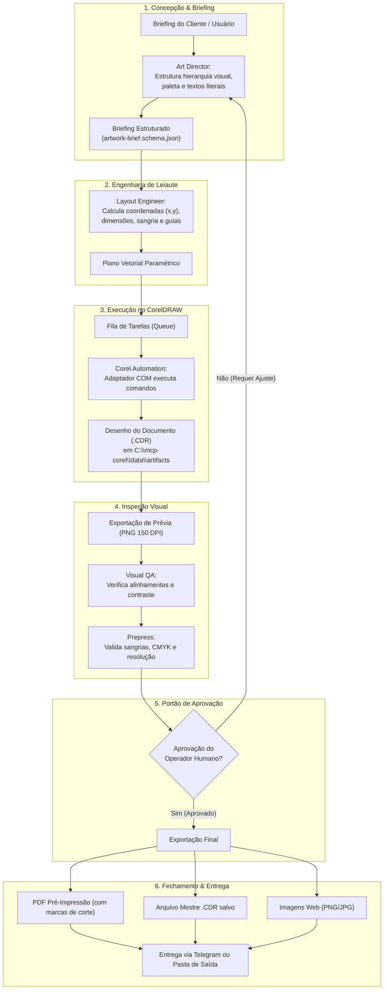
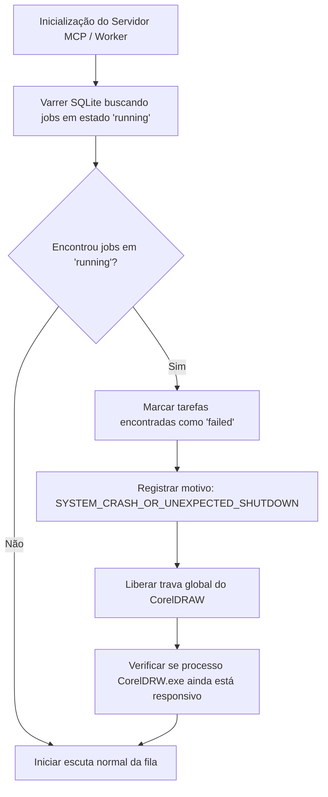

# Fluxos de Dados — MCP Corel

Este documento detalha o tráfego de dados, a máquina de estados de tarefas e o ciclo completo de criação artística no sistema **MCP Corel**.

---

## 1. Fluxo Completo de Criação de Arte (Briefing à Entrega)

O ciclo de vida de uma arte gráfica passa por 6 etapas bem definidas entre os agentes especializados e o CorelDRAW:

---

## 2. Máquina de Estados de Tarefas (Job State Machine)

Toda operação assíncrona registrada no sistema transita por estados controlados no banco de dados SQLite:

```mermaid
stateDiagram-v2
    [*] --> queued: Tarefa criada pela IA ou Telegram

    queued --> running: Fila inicia o processamento serial
    queued --> cancelled: Operador solicita cancelamento

    running --> needs_approval: Prévia gerada com sucesso, aguardando validação humana
    running --> succeeded: Operação sem necessidade de aprovação finalizada
    running --> failed: Erro de execução COM, timeout ou validação

    needs_approval --> running: Operador aprovou; iniciando exportação final
    needs_approval --> cancelled: Operador rejeitou a tarefa

    failed --> queued: Tentativa de reprocessamento (se configurada)
    failed --> [*]
    succeeded --> [*]
    cancelled --> [*]
```

### Tabela de Transições de Estado

| Estado Atual | Próximo Estado Válido | Disparador / Gatilho | Condição de Validação |
| :--- | :--- | :--- | :--- |
| `queued` | `running` | Fila liberada para novo item | Nenhuma tarefa em execução no CorelDRAW. |
| `queued` | `cancelled` | Chamada `corel.cancel_job` | Tarefa ainda não havia começado. |
| `running` | `needs_approval` | Prévia PNG gerada com sucesso | Configuração exige revisão humana antes de fechar. |
| `running` | `succeeded` | Operação concluída sem pendências | Artefato final gravado e validado. |
| `running` | `failed` | Exceção COM, timeout ou erro de disco | Código de erro registrado em `error_code`. |
| `needs_approval` | `running` | Comando `/aprovar` ou aprovação MCP | Confirmação explícita do operador. |
| `needs_approval` | `cancelled` | Rejeição do operador no Telegram/MCP | Motivo da rejeição registrado no job. |

---

## 3. Recuperação de Tarefas Órfãs após Falha do Sistema

Se a máquina Windows ou o processo do servidor for interrompido abruptamente enquanto uma tarefa estava no estado `running`:

