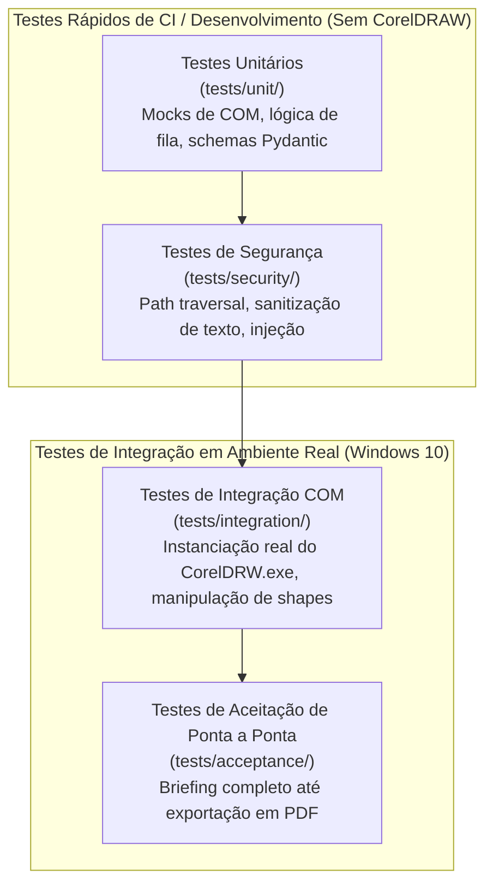

# Plano de Testes — MCP Corel

Este documento orienta a estratégia de validação da qualidade, segurança e conformidade do sistema **MCP Corel**, especificando as suítes de testes, ferramentas, ambientes e procedimentos de execução.

---

## 1. Estratégia e Níveis de Teste

A validação do projeto é organizada em quatro níveis complementares:



---

## 2. Matriz de Cobertura de Testes

| Suíte de Testes | Diretório | Dependência de Ambiente | Ferramenta Utilizada | Frequência de Execução |
| :--- | :--- | :--- | :--- | :--- |
| **Unitários** | `tests/unit/` | Linux / Windows (Sem Corel) | `pytest`, `pytest-asyncio` | A cada commit / pull request |
| **Segurança** | `tests/security/` | Linux / Windows | `pytest` | A cada alteração em handlers ou paths |
| **Integração COM** | `tests/integration/` | Windows 10 físico com Corel 2023 | `pytest -m live_corel` | Antes de mesclar fases de automação |
| **Aceitação E2E** | `tests/acceptance/` | Windows 10 físico com Corel 2023 | `pytest -m e2e` | Na validação de marcos e releases |

---

## 3. Detalhamento das Suítes

### 3.1 Testes Unitários (`tests/unit/`)
- **Validação de Schemas:** Garante que entradas inválidas (ex: dimensões negativas, cores fora do padrão CMYK/RGB) sejam rejeitadas com mensagens de erro claras antes de chegarem à fila.
- **Máquina de Estados de Jobs:** Valida se as transições permitidas (`queued` -> `running` -> `succeeded`) ocorrem corretamente e se transições inválidas (ex: `succeeded` -> `running`) são impedidas.
- **Serialização da Fila:** Simula múltiplas tarefas simultâneas para garantir que o worker as retire da fila uma a uma.

### 3.2 Testes de Segurança (`tests/security/`)
- **Sanitização de Caminhos (Path Traversal):** Testa tentativas de passar caminhos como `../../Windows/System32/calc.exe` ou `C:\autoexec.bat` para ferramentas de salvamento e importação. O sistema deve rejeitar todas com o código `ERR_SECURITY_PATH_OUT_OF_BOUNDS`.
- **Filtro de Allowlist do Telegram:** Testa simulação de mensagens recebidas de IDs desconhecidos, verificando se nenhuma resposta é emitida e se o evento é logado como alerta.
- **Prevenção de Injeção de Código:** Garante que textos de parágrafo contendo aspas, símbolos ou instruções de terminal não sejam interpretados como comandos de sistema operacional.

### 3.3 Testes de Integração Real com CorelDRAW (`tests/integration/`)
> [!IMPORTANT]
> Esta suíte só pode ser executada em máquina Windows 10 com o CorelDRAW 2023 instalado e com a flag `-m live_corel`.

- **Ciclo de Vida da Aplicação:** Testa a inicialização do objeto COM, verificação de visibilidade, criação de documento em branco e fechamento limpo sem deixar processos órfãos no Gerenciador de Tarefas do Windows.
- **Criação de Geometrias e Estilos:** Cria retângulos com cantos arredondados, elipses e linhas, conferindo via COM se as propriedades lidas correspondem aos parâmetros enviados.
- **Geração de Imagens de Prévia:** Exporta um PNG a 150 DPI e confere se as dimensões em pixels e o cabeçalho do arquivo PNG estão íntegros no disco.

### 3.4 Testes de Aceitação de Ponta a Ponta (`tests/acceptance/`)
- Simula o recebimento de um briefing completo (ex: Modelo Flyer Promocional), aciona o motor de leiaute, valida a prévia gerada, simula o sinal de aprovação e valida se o arquivo PDF resultante possui conformidade de pré-impressão (sangria de 3mm e resolução correta).

---

## 4. Como Executar os Testes

```bash
# 1. Executar testes rápidos (unitários e de segurança) em qualquer SO:
pytest tests/unit/ tests/security/ -v

# 2. Executar suíte de integração no Windows com CorelDRAW instalado:
pytest tests/integration/ -m live_corel -v -s

# 3. Gerar relatório de cobertura de código:
pytest --cov=src/mcp_corel --cov-report=html
```
