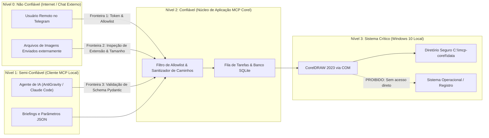

# Modelo de Ameaças (Threat Model) — MCP Corel

Este documento analisa os riscos de segurança, vulnerabilidades potenciais, vetores de ataque e controles mitigadores aplicados à estação de trabalho Windows 10 e ao ecossistema do **MCP Corel**.

---

## 1. Ativos a Serem Protegidos

1. **Integridade da Estação de Trabalho Windows:** Impedir execução de comandos de sistema operacional, instalação de programas indesejados ou corrupção do Windows.
2. **Documentos Mestres e Trabalhos de Clientes (.CDR):** Evitar perda, corrupção ou sobrescrita acidental de arquivos de design existentes.
3. **Segredos e Credenciais de Acesso:** Proteger tokens de autenticação (como o token do Bot do Telegram) contra vazamentos em logs ou repositórios.
4. **Disponibilidade da Aplicação CorelDRAW:** Prevenir travamentos, congelamentos em diálogos modais infinitos ou esgotamento de memória.
5. **Privacidade de Dados Gráficos:** Assegurar que imagens, contatos ou textos confidenciais contidos nas artes não sejam acessíveis por usuários não autorizados.

---

## 2. Fronteiras de Confiança (Trust Boundaries)

---

## 3. Matriz de Ameaças (Classificação STRIDE)

| Categoria STRIDE | Ameaça Identificada | Vetor de Ataque | Severidade | Controles Mitigadores Aplicados | Risco Residual |
| :--- | :--- | :--- | :--- | :--- | :--- |
| **Spoofing** (Falsificação) | Usuário mal-intencionado envia comandos ao bot Telegram fingindo ser o operador. | Envio de mensagens a partir de conta Telegram não autorizada. | **Alta** | Allowlist rígida por ID numérico (`TELEGRAM_ALLOWED_USER_IDS`). Mensagens de IDs desconhecidos são descartadas sem resposta. | Baixo |
| **Tampering** (Adulteração) | Tentativa de sobrescrever arquivos do sistema ou documentos existentes fora da pasta segura. | Parâmetro de caminho contendo `../../Windows/System32` (Path Traversal). | **Crítica** | Sanitizador de caminhos restringe toda operação a `SAFE_STORAGE_ROOT`. Bloqueio de caminhos relativos ou fora da raiz. | Mínimo |
| **Tampering** | Injeção de macros maliciosas para execução no CorelDRAW. | Payload contendo código VBA/VSTA enviado no briefing. | **Crítica** | Proibição absoluta de execução de macros em tempo de execução. Automação restrita a chamadas COM pré-compiladas. | Mínimo |
| **Repudiation** (Repúdio) | Operador nega ter aprovado ou solicitado o cancelamento de uma arte importante. | Falta de registro de ações administrativas. | **Média** | Auditoria completa persistida em SQLite com timestamp, ID de usuário e histórico de estados da tarefa. | Baixo |
| **Information Disclosure** (Vazamento) | Exposição do token do bot do Telegram ou dados confidenciais nos logs. | Leitura de logs de depuração gerados pela aplicação. | **Alta** | Sanitizador de logs mascara tokens e senhas. Arquivo `.env` ignorado no `.gitignore`. | Baixo |
| **Denial of Service** (Negação de Serviço) | Injeção de arte com milhões de nós vetoriais ou abertura de diálogo modal travando o CorelDRAW. | Briefing malicioso visando congelar o processo COM. | **Alta** | Watchdog de timeout (padrão: 60s), limite de tamanho de arquivos (máx 50MB) e supressão de alertas modais. | Médio |
| **Elevation of Privilege** (Elevação de Privilégios) | IA ou usuário tenta executar comandos do shell do Windows (`cmd.exe`). | Injeção de comandos em textos de parágrafo ou nomes de arquivos. | **Crítica** | O servidor MCP não expõe nenhuma ferramenta de execução de shell ou subprocesso arbitrário. | Mínimo |

---

## 4. Testes de Segurança Obrigatórios

1. **Teste de Evasão de Diretório (Path Traversal Suite):**
   - Injetar sequências `..\..\`, `/etc/passwd`, `C:\Windows\System32\cmd.exe` nos parâmetros de arquivo.
   - **Critério de Sucesso:** 100% das chamadas devem falhar com exceção de violação de segurança (`ERR_SECURITY_PATH_OUT_OF_BOUNDS`).

2. **Teste de Permissões Telegram:**
   - Simular mensagem vinda de ID `99999999` (não cadastrado).
   - **Critério de Sucesso:** Mensagem ignorada, nenhuma resposta disparada e tentativa registrada em log de segurança.
